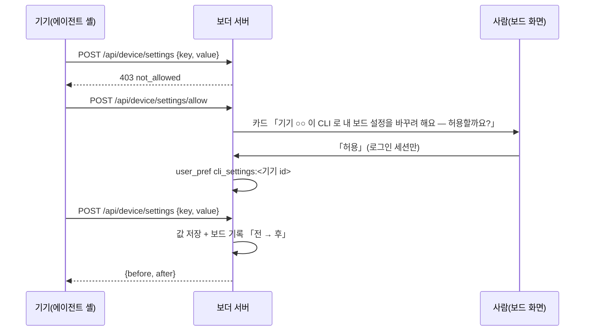

# 기기 CLI 로 내 보드 설정 읽기 · 바꾸기

에이전트가 사람 로그인 브라우저나 손 API 호출로 하던 보드 설정을 `boarder` 명령으로 옮긴다. 서버 `apps/web/worker/device-settings.ts`, CLI `packages/cli/src/settings.mjs`.

## 권한

| 하는 일 | 필요한 것 |
|---|---|
| 읽기(`… show`) | 회원 기기 토큰(scope full). 주인 기기 · 감시 기기는 401 |
| 바꾸기(`… set`) · 역할 자리표 올리기 | 위 + 그 회원이 보드 카드에서 **이 기기**를 한 번 「허용」. 없으면 403 `not_allowed` |
| 화면 덧씌우기 js 올리기(`boarder view overlay js`, `boarder harness wrapper ui on`) · 래퍼 `side.pins` 바꾸기 | 위와 같은 허락. 없으면 403 `not_allowed`. 주인 기기는 예외(`settings allow` 가 막혀 있어 지금 그대로) |
| 화면 덧씌우기 css · js 비우기 · 지금과 같은 값 다시 올리기 · 읽기 | 회원 기기 토큰(허락 없이) |
| 같은 일을 같은 사이트 로그인 화면에서 | 로그인 세션(허락 없이) |
| 허락 카드 세우기(`boarder settings allow`) | 회원 기기 토큰 — 카드만 서고, 허락은 사람만 |
| 창 토큰 다시 받기(`boarder window renew`) | 회원 기기 토큰(그 기기 자신의 창 — 계정 설정 아님) |

- 허락 카드 답은 사람 로그인 세션만 받는다. 요청에 `authorization` · `x-boarder-device` 머리가 있으면 401 — 새 기기 · 커넥터 허용 카드와 같은 막기. 그래서 기기의 에이전트가 기기 토큰으로 스스로 허락할 수 없다.
- 허락은 기기마다 `user_pref` 의 `cli_settings:<기기 id>` 한 줄. 다른 기기로 번지지 않고, 기기를 끊으면(revoke) 기기 토큰이 죽어 쓸 수 없다. `boarder settings revoke` 로 그 기기가 스스로 거둘 수 있다.
- 요청은 10분 뒤 만료(`… allow` · `settings show` 를 읽을 때도 만료 카드를 닫음), 회원마다 기다리는 요청 셋까지, 같은 기기는 카드 하나.
- 거절하면 그 기기의 요청은 24시간 429, 답이 없어도 기기마다 하루 다섯까지 429 — 카드 · 폰 푸시가 끝없이 나가지 않게(`device-card.ts` 와 같은 꼴, 표 `device_card_event`). 다른 기기는 따로 센다.
- **js 도 허락 뒤인 까닭:** 덧씌우기 js 는 회원 로그인 화면에서 돌아 쿠키와 `x-hb` 로 `/api/me/cards/<id>/answer` 를 부를 수 있다. 토큰 머리를 보는 막기로는 못 막고, 래퍼 칸의 동의 해시도 기기가 직접 계산해 넣을 수 있다. 그래서 허락 카드에 「내 화면에서 나처럼 움직이는 스크립트도 올릴 수 있어요」를 적는다. 이미 js 를 올리던 팀 기기도 다음 쓰기 때 `boarder settings allow` 를 한 번 해야 한다.

## 흐름

## 명령과 저장 자리

| 명령 | 서버 칸(key) | 저장 자리(화면 길과 같음) |
|---|---|---|
| `boarder pins show \| set <캔버스 id\|주소\|id=제목>… \| set --none` | `pins` | `node_setting.$.pins`(side-order.ts) |
| `boarder task-channels show \| set on\|off` | `task_channels` | `node_setting`(node-prefs.ts) — 바꾸면 바로 다시 묶음 |
| `boarder task-repo show \| set <owner/repo> \| set off` | `task_repo` | `node_setting` — 바꾸면 바로 다시 묶음 |
| `boarder front-door show \| set --name <이름> --fold <노드>… [--alias <옛 이름>…] \| set off` | `front_door` | `node_setting` — 이름이 정확히 같은 내 노드(업무 · Slack 노드 제외)를 찾고, 이름마다 찾고, 하나라도 없으면 404 + `missing` 이고 아무것도 안 바꿈 |
| `boarder primary-window show \| set <window:…\|ew_…> \| set off` | `primary_window` | `user_pref primary_win` — 내 살아 있는 창만 |
| `boarder bot show \| set --name <이름>` | `bot_name` | `member_bot.name` 만(모양 · 그림 그대로). 봇이 없으면 409 |
| `boarder roles show \| set <file.json\|->` | — | `POST /api/device/roles`(member-channels.md 「역할 자리표」) |
| `boarder window show \| renew` | — | `POST /api/device/window`(토큰 값은 안 찍음) |

바꾸기 답은 `{ ok, key, before, after }`, CLI 는 여기에 `undo`(전 값으로 되돌리는 명령)를 붙여 찍는다. 보드 「보더」 기록에 `기기 「○○」 이 CLI 로 △△ 을 바꿨어요 — 전: … → 후: …` 한 줄이 남는다. 허락받은 기기의 `POST /api/device/roles` · `/api/device/pins` 도 같은 줄을 남긴다(자리표가 앞단 접기를 바꾸면 그것도, 같은 값을 다시 올리면 안 남김).

`boarder roles set` 의 `undo` 는 저장된 표 그대로(`GET /api/device/roles` 의 `roles` — `primary` · `fold` · `node` 포함)를 다시 올리고, 앞단 접기가 걸린 표면 이어서 `boarder front-door set …` 으로 전 값까지 되돌린다.

