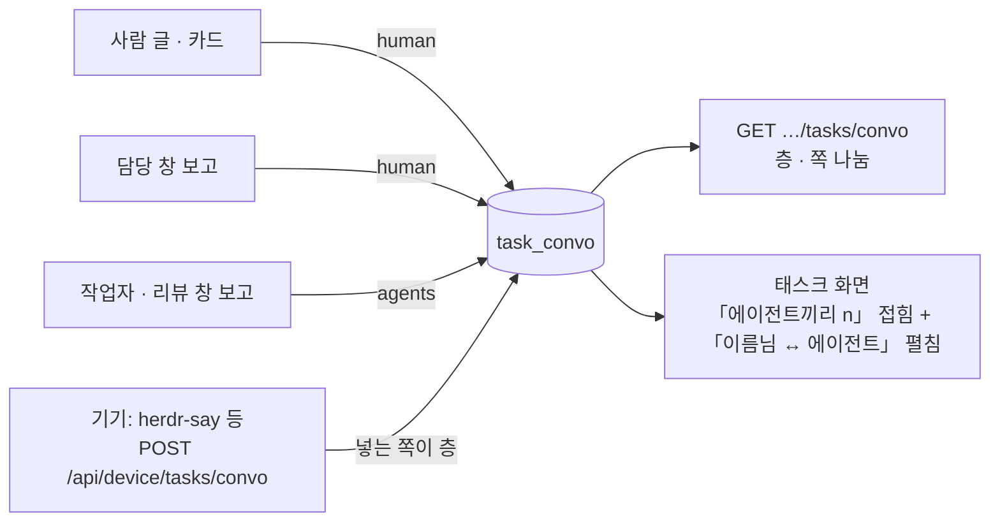

# 회원 보드의 앞단과 채널

앞단 하나 · 채널 = 태스크 흐름 판. 둘 다 사람마다 켜는 설정(node_setting.data, apps/web/worker/node-prefs.ts) 뒤에 있다.
설정이 없는 회원(기본값)과 주인 보드는 예전 그대로다 — 묶기 결과가 main 과 같은지는 apps/web/worker/importer/task-channel-off.test.ts 가 사례 39개로 대조한다.

## 앞단 하나(front_door, 설정한 사람만)

설정 꼴: `{ "name": "비서실장", "panes": ["%1234567", …], "names": ["회사", "팀장"], "aliases": ["옛 메인 봇 이름"] }` — panes[i] 와 names[i] 가 짝.
설정 › 노드 API(`POST /api/me/nodeset` 의 `{ "prefs": { "front_door": … } }`)로 넣고, `null` 이면 끈다.

| 진입 | 설정 없음 | 설정 있음 |
|---|---|---|
| 왼쪽 앞단 | 메인 봇 · 고른 노드 각각 | 설정한 이름 한 칸 |
| 고른 노드의 이름/판 주소 | 각 노드 | 그 한 칸의 통합 대화 |
| 옛 앞단 글 검색 결과 | 각 노드 | 그 한 칸의 해당 글/스레드 |
| 새 요청 | 누른 앞단의 창 | 기존 Primary 전송 경로 |
| 옛 노드 스레드의 답 | 원래 담당 창 | 원래 담당 창 |

원본 노드·창·카드·대화는 유지한다. 판 번호와 정확한 이름이 둘 다 맞는 노드만 묶는다. 두 창이 같은 Claude 대화인지는 판단하지 않는다.

## 채널 = 태스크(task_channels, 켠 사람만)

설정 › 노드 「업무 노드」의 「채널 = 태스크」 스위치(또는 `prefs.task_channels: true`). 번호만 있는 업무(#123)의 리포는 `prefs.task_repo: "owner/repo"` — 없으면 리포를 추정하지 않는다.

| 진입/자료 | 꺼짐(기본) | 켬 |
|---|---|---|
| 창 제목에 업무 #번호 | 제목 60자로 만든 창별 채널 | 해당 번호의 기존 tk_ 업무 채널 |
| 같은 Claude session id로 다른 기기/계정에서 다시 엶 | 새 창 칸 | 같은 업무/대화 칸 |
| 같은 업무의 작업자와 연결된 PR 스레드 | 창별로 흩어짐 | 업무 채널의 항목 |
| 옛 창의 보고·카드 | 옛 창 칸 | 같은 업무 채널(창이 닫혀도 업무가 열려 있는 동안) |
| 옛 노드에 사람이 남긴 글/주소 | 옛 칸 | 저장한 별칭으로 업무 채널 |
| 왼쪽 목록 | 업무는 숨김 | 업무는 채널, 부서는 에이전트 |
| 사람이 직접 옮긴 창 | pin | pin 우선, 같은 세션을 이어 연 창도 따라감(스레드 하나만 옮기면 그것만) |
| 창 없는 보고자 | 가장 큰 에이전트 채널 | 보낸 이름 채널 · 업무 · 보관 시간 넘게 조용하면 보관 |

업무 번호가 중복되어 구별할 수 없거나, 리포가 다르거나, 이미 끝난 업무이면 자동으로 붙이지 않는다. session id가 전달되지 않으면 같은 대화라고 추정하지 않는다. 수신 창은 업무의 기존 주 창이 살아 있으면 유지하며, 사라졌으면 현재 연결된 창으로 바꾼다.

## 역할 자리표(roles, 표를 올린 사람만)

앞단 에이전트(비서실장 · 부서장)를 창 열쇠(기기 + 창 번호)가 아니라 역할 이름에 묶는다. 표: 역할 이름 → 지금 그 역할을 맡은 창(win). 저장은 `node_setting.data.roles`, 코드는 `apps/web/worker/role-seat.ts`.

- 올리기: `POST /api/device/roles { "roles": [{ "name": "기술장", "win": "host1:ew_tech02" }, { "name": "비서실장", "win": "host2:ew_…", "primary": true }] }` — 보드에서 「설정 바꾸기」를 허락받은 기기 토큰(`boarder settings allow`, [기기 설정](device-settings.md)) 또는 같은 사이트의 내 화면. 허락 없는 기기 토큰은 403. CLI 는 `boarder roles set <file.json>`. 표 전체를 바꾼다. 한 줄이라도 틀리면 400(반만 저장 안 함). `node: "tk_…"` 로 역할 노드를 직접 고를 수 있다(없으면 이름이 같은 열린 업무 노드 하나).
- 읽기: `GET /api/device/roles` — 자리마다 판정(붙음 · 창이 아직 안 들어옴 · 역할 노드 없음 · 같은 이름 노드가 여럿 · 다른 역할이 이미 이 창).

| 일 | 표 없음(기본) | 표 있음 |
|---|---|---|
| 역할 창이 다른 기기 · 계정 · Codex↔Claude 로 옮김 | 새 창은 부서 노드 밖 — 부서에 쓴 글은 배정기로, 새 창 답은 다른 칸 | 표만 고치면 새 창(과 같은 대화)이 부서 노드에 pin, 주 창 = 새 창 |
| 부서 에이전트에 쓴 글 | 주 창이 닫혔으면 배정기 | 지금 그 역할의 창 |
| 옛 창의 글 | 옛 칸(닫혀 하루 지나면 안 보임) | 같은 부서 대화(`counts.past` 에 옛 창 이름, 최근 20) |
| 비서실장(primary) | 메인 봇 창 = 설정 › 노드 고른 창 | 표의 창이 메인 봇 창(`primary_item`)이 됨 |
| Primary 채팅 글 | 메인 봇 창 | 지금 「비서실장」 창 — 비서실장이 부서장 · 다른 에이전트로 나눔(기존 chat_split 길) |
| 옛 앞단(「회사」 · 「팀장」 · 「Chief of Staff」) | 각자 왼쪽 칸 | 비서실장 자리의 `fold` 이름들 → 앞단 설정(front_door)으로 Primary 한 칸에 모음. 원본 노드 · 글은 남음, 없는 이름은 응답 `front.missing` |
| 옛 앞단 칸의 글 | 그 칸 대화에만 | Primary 대화에 시각 순으로 섞여 이어지고 줄마다 표지 「옛 회사」 · 「옛 팀장」 · 「옛 Chief of Staff」(글 머리 `tag`). 카드 · 지난 대화 접힘도 같은 표지. 새 글은 Primary 로만 |
| 창이 아직 안 들어옴 | — | 아무것도 안 바꿈. 다음 들여오기 뒤 묶기에서 붙음 |

표를 올리는 쪽은 사람의 기기 도구다(역할 → 창 표를 가진 쪽). 창이 옮길 때마다 표 전체를 다시 올린다.

### Primary 글이 가는 창

비서실장 자리의 창은 보더 엔진 창(엔진 `tmux`)인 경우가 많다. 메인 봇 판정(`group.ts canBePrimary` — 그 사람 tmux · Herdr 창만)은 엔진 창을 거절해서, 표가 넣은 `primary_item` 이 조용히 무시됐다.
기본 창(`user_pref primary_win`)이 비어 있으면 Primary 글은 주차된 보더 메인 봇으로 가 엔진 reopen 한 줄로 끝났다 — 글이 어느 창에도 안 가고 표시도 없었다.

| 순서 | 전 | 후 (`primary-send.ts primarySend`) |
|---|---|---|
| ① 기본 창(`primary_win`)이 살아 있음 | 그 창 | 그 창(그대로) |
| ② 기본 창이 비거나 죽음 · 고른 메인 봇 창(`primary_item` = 들여온 창 키)이 살아 있음 | 엔진 메인 봇 길(`chatToMain`) — 엔진 창이면 무시돼 보더 메인 봇 reopen | 그 창(`chatToMain` 이 들여온 메인 봇 창에 넣는 길 `toImported` 그대로 — 전문 · 줄바꿈 · 답하는 길 한 줄 · `post`, 응답 `{queued, primary}`. 주차한 엔진 창만 `queueToImported(whole)` — 연달은 글이 다시 열기 하나에 모임) |
| ③ 둘 다 아님 | 엔진 메인 봇 길 | 엔진 메인 봇 길(그대로) |
| 어느 창에도 못 넣음(엔진 길이 창을 못 엶 · 넣다 오류) | 아무 표시 없음 | Primary 채팅에 보더 줄 「방금 글이 창에 안 들어갔어요 …」 |
| 주차된 창을 글과 함께 다시 엶(`deliver` → `reopen`) · 기기는 ok 인데 창이 안 뜸 | 아무 표시 없음(`{reopened:true}` 로 끝) | 엔진 DO 가 지켜봄(`reopens`): 기기가 창이 살았다고 올리면 끝, hello 에 없음 · `state none` · 첫 턴 오류면 보더 줄 「「창」 창이 다시 뜨지 않아 방금 글이 안 들어갔어요 …」. 10분 넘게 안 뜨면 그 창을 닫고 gone 으로 맞춘 뒤 같은 줄(늦게 떠 글이 두 번 들어가지 않게). 답을 못 받거나 목록을 못 읽은 hello 면 판정을 미룸 |
| 고른 메인 봇 창이 엔진 창인데 서버 표(`engine_window`)는 주차 · 사라짐 | 들여온 표(`imp_item`)가 산 꼴이면 소켓 줄에 서서 `no such window` 로 표시 없이 실패, gone 이면 엔진 메인 봇으로 감 | 서버 표를 먼저 봄: 그 창을 다시 열며 넣음(`deliver`). 다시 열 손잡이가 없고 들여온 줄도 gone 이면 엔진 메인 봇 길 |
| 소켓으로 넣다 실패(`primary` 표지가 붙은 글) | `engine_cmd` failed · 표시 없음 | 창이 없으면(4) 다시 열며 넣음, 못 하면 · 그 밖의 실패면 보더 줄 「방금 글이 창에 안 들어갔어요 …」. 바쁨은 예전처럼 다시 넣을 줄로 |

통화(voice)의 Primary 넣기도 같은 함수다.

## 트리 정리(tree_tidy, 자리표 있는 사람 — 설정 › 노드, 기본 켬)

메인 봇 바로 밑에는 창이 늘 없어야 한다. 자리표가 있는 사람의 노드 트리에서 메인 봇 바로 밑(`area primary`)에 창을 두지 않는다. 지우지 않고 숨기기만 한다.

| 일 | 전(자리표 없음 · 끔도 같음) | 후 |
|---|---|---|
| 메인 봇 아래 | 열 머리를 못 정한 창(머리 없는 영역 · 상위 없는 작업자 · 다른 기기 일회성 창 · 주차 노드)이 메인 봇 바로 밑 | 자리표 부서 열만(`areas[].seat`) |
| 열 머리를 못 정한 창 · 주차 노드 | 메인 봇 바로 밑 | 「분류 안 됨」 열(`area unsorted`, 머리 없음) |
| 자리표 밖 열(머리가 부서가 아닌 열) · 「분류 안 됨」 | 펼쳐진 열 | 접힌 「그 밖의 창 n」 단추 안 — 누르면 펼침 |
| 창이 다 닫힌 노드(업무 · 부서 · 밑에 노드를 둔 것 빼고) | 주차로 남다가 보관 시간 뒤 빠짐 | 바로 닫힌 목록(`closed`) |
| 기본 창(`primary_win`) | — | 건드리지 않음 |

### 부서 묶음 · 노드 순서 · 사이드바 부서 그룹

| 일 | 전 | 후 |
|---|---|---|
| 트리, 메인 봇 아래 | 부서 열이 바로 | 묶음 노드 하나(이름 = 내 조직 이름, 조직이 하나일 때 — 없으면 「부서」) → 그 밑에 부서 열 |
| 같은 깊이 노드 순서 | 서버가 정한 순서(우선순위 · 내 차례) | 끌어 놓아 바꿈 — 형제의 가장자리(앞 · 뒤 30%, 열 머리끼리는 좌우)에 놓으면 순서, 가운데는 예전처럼 그 노드 아래로. 휴대폰은 꾹 누른 판의 「앞으로 한 칸 · 뒤로 한 칸」 |
| 순서 저장 | — | `POST /api/me/nodes/order { panes: [%N…] }`(회원 · 같은 사이트 · 내 노드만, 형제 2~60개) → `node_setting.data.order`(사람마다, 새 기기에서도 같음). 열 · 열 안 노드(`ord`) · 사이드바 부서 그룹이 이 순서 |
| 사이드바(자리표 있는 사람) | 「에이전트」(메인 봇 + 부서장) · 「태스크」(번호 있는 업무) 두 칸 | 맨 위 메인 봇(늘 보임) → 부서 그룹마다 머리 = 부서장(누르면 부서장 대화), 밑 = 그 부서 태스크. 부서를 못 정한 태스크는 맨 끝 「부서 없음」, 끝난 태스크는 맨 끝 접힌 칸 |
| 태스크의 부서 | — | `task_side[].dept`: 상위 사슬의 자리표 부서 → 아니면 업무 칸 `fields.dept`(또는 `부서`) 값(dept:tech · tech · 기술 · 기술장 모두 기술장) |
| 그룹 접기 | — | 그룹마다(처음엔 접힘, 이 브라우저에 기억). 접힌 그룹 머리에 새 글 · 내 차례 수 |

화면 글의 「Primary」(통화 단추 · 오른쪽 판 단추 · 스레드 입력 안내 · 멘션 목록 · 영역 이름)는 회원이면 메인 봇 이름(예: 비서실장)으로 보인다. 주인 보드는 그대로다.

## 사이드 「태스크」(채널 = 태스크를 켠 사람만)

왼쪽 「채널」 칸 대신 「태스크」 칸: 번호가 있는 업무 노드(부서 묶음 빼고)를 `#번호 · 제목 · 상태(진행 · 막힘 · 기다림 · 완료 · 취소)`로 보인다. 자료는 `/api/data` 의 `task_side`(member-board `taskSide`).

| 일 | 전 | 후 |
|---|---|---|
| 왼쪽 목록 | 「채널」 = 업무 노드 · 창 노드(작업자 · 담당 창 · 옛 칸) 섞임, 중요도 순 | 「태스크」 = 번호 있는 업무만, 진행 중 먼저 · 최근 글 순, 끝난 것은 접힌 「끝난 태스크 n」 안 |
| 태스크 누름 | — | 그 태스크 대화(붙은 창 · 작업자 · 옛 칸 글 · 카드가 한 대화) |
| 태스크 안에서 쓴 글 | — | 그 태스크의 지금 담당 창(주 창) |
| 「에이전트」 칸(역할 자리표가 있을 때) | 메인 봇 + 모든 열 머리 | 메인 봇 + 자리표 역할의 부서 노드만(`role_seats`) |

번호 없는 창 · 태스크를 모르는 작업자 창은 목록에서 빠질 뿐 기록은 그대로다(노드 트리 · 찾기에서 보인다).

## 태스크 대화 표(task_convo)

태스크 하나 = 대화 하나를 보더 서버 DB 에 따로 쌓는다(어떤 기기 · 어떤 세션이 붙든 이어지게). 표 `task_convo`(migrations/0060), 코드 `apps/web/worker/task-convo.ts` · `member-board.ts` `syncTaskConvo` · `taskLayers`.

- 칸: `task_id`(업무 키 — 노드 id `tk_<키>`) · `layer`(`human` 사람 ↔ 에이전트 · `agents` 에이전트끼리) · `who` · `at`(ms) · `source` · `text` · `src_ref`(같은 사람 · 같은 태스크에 같은 값이면 한 줄). 그 밖에 `owner` · `id` · `created_at`.
- 쓰기: `POST /api/device/tasks/convo { "task": "1234", "rows": [{ "layer": "agents", "who": "…", "at": 1793… , "source": "herdr-say", "text": "…", "src_ref": "herdr:…" }] }` — 기기 토큰 또는 같은 사이트의 내 화면(`/api/me/tasks/convo`). `task` 는 키 · `#번호` · `tk_키` · `저장소#번호`(저장소가 다르면 404 — 번호만 있는 업무는 설정 `task_repo` 로 읽고, 설정이 없으면 저장소를 몰라 거절). 내 업무 노드가 아니면 404. 한 번에 500줄, 답 `{ added, dup }`. `at` 은 ms · 초 · ISO.
  - 거절: `src_ref` 가 `board_log:` · `card:` 로 시작(보드 줄 몫, 400) · `at` 이 지금 + 하루 뒤(400) · 몸통 2MB 넘음(머리값 없어도 실제로 잼, 413) · 사람마다 하루 5만 줄 넘음(새 줄만 셈 — 겹침 · 보드 줄은 안 셈, 429 + `left`).
  - 저장 전 가림: `text` · `who` · `source` 의 비밀 꼴은 `[secret]` 으로 저장(MCP 쓰기와 같은 `redact`). `src_ref` 는 키라 안 가림.
- 읽기: `GET /api/device/tasks/convo?task=1234&layer=human&limit=100&after=<next>` — at · id 순, 쪽 나눔 `next`, 층마다 수 `counts`. 읽기 전에 그 태스크의 보드 줄을 표에 맞춰 넣음(`sync=0` 이면 안 함).
- 맞춰 넣기: 최근 장부 600줄 + 장부가 그보다 많으면 그 태스크 창 이름으로 찾은 옛 줄(한 번에 2000줄까지, 같은 창들이면 다시 안 훑음). 스레드 답 줄도 넣음(카드 스레드 줄은 빼고), 층은 누가 썼나로. 담당 창은 이름 ↔ 키를 맞춰 봄(장부 줄 win = 이름, 주 창 = 키).
- 따라오는 것: 내 글 고침(표 글도) · 지움(표 줄도) · 몫 글 옮김(옛 태스크 표에서 빠지고 옮겨 간 태스크에 다시 들어감) · 못 넣어 지운 글. 묶기가 바뀌어 창이 다른 태스크로 가면 옛 줄은 옛 태스크 표에 그대로 남음.

| 일 | 전 | 후 |
|---|---|---|
| 태스크 대화가 어디 남나 | 붙은 창들의 장부 줄(board_log)을 그때그때 모아 보임 — 창이 하루 넘게 닫히거나 묶기가 바뀌면 안 보일 수 있음 | 표 `task_convo` 에 한 줄씩 쌓임(보드 줄 = `board_log:<id>`, 카드 = `card:<id>`, 기기가 넣는 줄 = 기기가 정한 키) |
| 층 | 없음 — 사람 글 · 담당 창 · 작업자 · 리뷰 창 글이 한 줄로 섞임 | 사람 글 · 카드 · 담당 창(사람 글이 들어가는 창 — 주 창, 없으면 첫 창) = `human`, 그 밖 창 = `agents`. 담당 창이 없으면(창이 다 닫힘 · headless) `human`. 기기 줄은 넣는 쪽이 정함. 한 번 정한 층은 안 바뀜 |
| 태스크를 열면 | 모든 줄이 시각 순 | 맨 위 접힌 글 「에이전트끼리 n」(누르면 그 스레드에 `agents` 줄 시각 순), 그 아래 이름표 「<이름>님 ↔ 에이전트」 와 `human` 줄(기본 펼침). 스레드가 달린 `agents` 줄은 접지 않고 채널에 답글 수와 남음. 같은 글이 보드 줄 · 기기 줄로 둘이면(같은 층 · 5분 안) 화면엔 보드 줄 하나(표 · API 는 둘 다) |
| 접은 글 스레드에 쓴 답 | — | 그 태스크 채널 글로 담당 창에 감. 첫 줄이 바뀌어 낡은 ts 로 열어 둔 칸도 읽기 · 쓰기 다 그 태스크(그 초에 agents 줄이 있고 진짜 글이 아닐 때만). 내 Primary 글은 ts 끝이 같아도 그 글 스레드 |
| 접은 글의 수 · ts | — | 수 = 표 전체 줄 수(600 을 넘어도 실제 수), ts = 표에서 가장 옛 agents 줄 기준이라 새 줄에 안 바뀜. 스레드에 펼치는 줄은 최근 600 |
| 채널에 글로 나온 기기 줄 · 뿌리가 밀린 답에 답글 | — | 기기 줄 = 그 줄 하나로 열리고 답글은 태스크 채널 글로 담당 창에. 답 줄 = 그 뿌리 스레드가 열리고 답글도 그 스레드로(뿌리가 지워졌으면 그 줄 하나 · 채널 글로) |
| 태스크 창이 옆 노드 글 스레드에 쓴 답 | 옆 스레드에만 | 그대로 옆 스레드에만(내 채널 · 접은 글에 안 나옴). 표 · 읽기 API 에는 있음 |
| 화면이 장부를 읽은 뒤 글을 지움 · 고침 · 옮김 | — | 표에 넣을 때 장부 줄이 그대로인지 봄: 지운 글은 안 들어가고, 고친 · 옮긴 글은 다음 읽기가 새 값으로 넣음 |
| 보드에서 내 글을 지움 | 장부 줄만 지움 | 표의 그 줄(`board_log:<id>`)도 지움 |
| 채널 = 태스크를 끈 사람 | — | 예전 그대로(접은 글 · 이름표 없음). 표 쓰기 · 읽기 API 는 됨 |

## 찾기 — 태스크 먼저 · 결과 굴림(회원)

| 일 | 전 | 후 |
|---|---|---|
| 찾기 결과 차례 | 에이전트 → 모아 보기 → 노드 → 결정 · 할 일 → 대화 → 캔버스 | 맨 위에 「태스크」(사이드 태스크 자료 `task_side` — #번호 · 제목 · 상태 표지, 낱말이 번호 · 제목 · 상태에 맞는 것, 빈 칸이면 진행 중 다섯). 누르면 그 태스크 화면. 그 아래는 그대로 |
| 찾기 결과 굴림 | 결과 칸이 상자 높이만큼(세로 flex 안 굴림 칸) | 결과 칸 `min-height:0` · `overscroll-behavior:contain` · 폰은 화면 높이(`dvh`) 안으로 |

## 사이드바 폭 · 태스크 이름 두 줄

| 일 | 전 | 후 |
|---|---|---|
| PC 사이드바 폭 | 264px 고정 | 오른쪽 끝 손잡이를 끌어 200~480px · 두 번 누르면 기본 264 · 손잡이에 초점을 두고 ← → 로 16px씩. 값은 계정 화면 설정(`/api/me/ui` `sbw`, 0 = 기본)과 이 브라우저 사본(`hb-sbw`) — 다른 기기에서 열어도 같은 폭 |
| 본 칸 · 대화 판 · 피드 왼쪽 끝 | 264px | 사이드바 폭을 따라감(`--bx-sbw`) |
| 사이드 「태스크」 이름이 길 때 | 한 줄 … | 두 줄까지 감싸고 더 길면 …, 마우스를 올리면 전체 이름(title). 폰 메뉴도 두 줄 |
