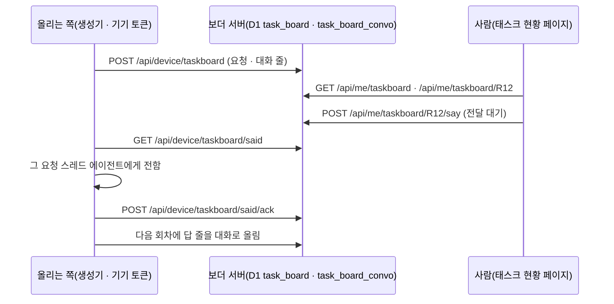

# 상태 페이지 — 태스크 현황 · 기기 세션 현황

둘 다 사람마다 켜는 기능이다(설정 › 기능, 계정 값 `user_pref` 의 `feat:taskboard` · `feat:devboard`, 기본 꺼짐).
배포에서 통째로 끄려면 wrangler vars `FLAGS_OFF` 에 `taskboard` · `devboard` 를 넣는다 — 켠 사람도 꺼진 것과 같다.

| 진입 | 꺼짐(기본) | 켬 |
|---|---|---|
| 사이드바 「피드」 밑 | 줄 없음 | 「태스크 현황」 · 「기기 세션 현황」 |
| 주소 `/task-status` · `/device-sessions` | 보드 첫 화면(노드) | 그 페이지(새로 고침 · 링크로 바로) |
| 그 페이지 API(`/api/me/taskboard*` · `/api/me/devboard*`) | 403 | 자기 것만 |
| 기기 올리기(`/api/device/taskboard*`) | 403 — 받지 않음 | 그 기기 주인 칸에만(full 기기 토큰만 — 감시 · 하네스 토큰은 401) |

## 태스크 현황 — 올리는 쪽(기기 토큰)

에이전트 쪽 도구(생성기)가 boarder 기기 토큰(`Authorization: Bearer bxd_…`)으로 올린다. 보더는 받은 것을 그리기만 한다 — 요청을 묶거나 상태를 판단하지 않는다.

`POST /api/device/taskboard` — 본문 1MB · 요청 300 · 대화 1000줄까지(넘으면 413)

```json
{
  "tasks": [{ "id": "R12", "title": "…", "quote": "요청 원문", "status": "진행", "state": "working",
              "dept": "제품", "assignee": "제품장", "area": "제품 · 고객", "done": "한 일", "next": "남은 것", "q": "Q-41",
              "prs": [{ "n": 512, "state": "open", "url": "https://…" }], "tasks": ["#301"], "logs": ["작업 기록 줄"],
              "requested_at": 1793700000, "updated_at": 1793710000, "completed_at": null, "src_ref": "원 글 자리" }],
  "convo": [{ "task_id": "R12", "k": "줄 열쇠", "layer": "human", "who": "비서실장", "mine": false, "at": 1793700000,
              "source": "board", "text": "…", "src_ref": "…" }],
  "remove": ["R09"]
}
```

- `id` 는 글자 · 숫자 · `. _ -` 1–40자. 같은 `id` 는 덮어쓴다. `state` 가 없으면 `status` 글자(진행 · 막힘 · 기다림 · 끝 · 안 함 · 멈춤)에서 고른다.
- 대화 줄은 `k`(없으면 `src_ref`, 그것도 없으면 시각 · 이름 · 글 앞부분)가 같으면 한 번만 들어간다. 그 요청이 없으면 버린다.
  한 스레드의 여러 줄을 `src_ref` 하나로 올리면 첫 줄만 남으니 줄마다 `k` 를 준다.
- 응답 `dropped` = 망가진 요청 · 줄 + 안 들어간 줄(없는 요청, 같은 열쇠인데 글이 다른 줄). 같은 줄을 다시 올린 것은 안 센다.
- `remove` 는 그 요청과 전달 끝난 줄을 지운다. 전달 대기 말은 남아 올렸던 기기가 가져가고, ack 하면 그때 사라진다.
- `layer`: `human` = 사람 ↔ 에이전트(세부 화면에서 펼침), `agent` = 에이전트끼리(이어진 줄을 한 묶음으로 접음). `mine: true` = 보드 주인이 쓴 줄(오른쪽 말풍선).
- 시각은 ms · 초 숫자나 ISO 글. PR 주소는 `https://` 만 남긴다. 받는 칸 밖의 값은 버린다.

사람별 한도(공용 DB 를 한 사람이 채우지 못하게, 넘으면 429 · 아무것도 안 들어감): 요청 2000 · 대화 2만 줄 · 대화 글 50MB, 하루 올리기 5000번 · 새 줄 5000 · 말하기 500번(UTC 날짜마다 다시). 있던 요청 덮어쓰기와 같은 줄 다시 올리기는 한도를 안 먹는다.
보관 기간 90일: 그동안 다시 안 올라온 요청과 받은 지 90일 넘은 줄(전달 못 한 말 포함)은 매일 정기 작업이 지운다.
화면 위 「마지막으로 올라온 때」는 요청이든 대화 줄이든 기기가 마지막으로 올린 때다(사람의 「말하기」는 안 센다).

CLI 로 올리면 토큰을 다루지 않아도 된다(이 기기 토큰을 명령 안에서만 씀, 크면 상한 밑으로 나눠 요청 → 지우기 → 대화 순):
`boarder taskboard push <file.json>` · `boarder taskboard said` · `boarder taskboard ack <file.json>`.

태스크는 「올린 기기의 주인 메일」 칸에 쌓이고 그 메일로 로그인해야 보인다. 주인처럼 메일이 여럿인 사람은 올리는 기기를 승인한 메일과 같은 메일로 봐야 한다(기기 세션 현황과 달리 메일 여럿을 묶지 않음 — 회원은 메일 하나라 해당 없음).

「말하기」(보더 세부 화면에서 쓴 말)는 보더가 전하지 않는다 — 올리는 쪽이 가져가서 그 요청 스레드(에이전트)로 전한다.

- `GET /api/device/taskboard/said` → `{ said: [{ task_id, k, who, at, text }] }`(전달 대기 줄, 100개까지). 그 요청을 마지막으로 올린 기기만 받는다(요청이 지워졌으면 말을 쓸 때 올렸던 기기).
  가져간 줄에는 표시가 남아 또 나가지 않고, 5분 안에 ack 가 없으면 다시 나간다(기기가 가져간 뒤 죽어도 말이 안 사라짐).
- 전한 뒤 `POST /api/device/taskboard/said/ack` `{ keys: [{ task_id, k }] }` → 화면의 「전달 대기」 표지가 빠진다. 가져간 기기의 ack 만 먹는다.
- 가져간 말을 대화 줄로 다시 올릴 때는 `said` 가 준 `k` 를 그대로 쓴다 — 다른 `k` 면 같은 말이 두 줄로 보인다.



## 기기 세션 현황 — 새로 모으지 않음

기기 노드가 이미 올리는 값만 읽는다. 기기 이름 · 계정 글자를 코드에 박지 않아, 누구든 자기 기기 · 자기 계정이 그대로 보인다.

| 화면 칸 | 어디서 | 누가 올림 |
|---|---|---|
| 기기 · 켜짐 | `device`(이름 · 마지막 연락 · 엔진 연결 시각) | `boarder setup` 으로 붙은 기기 |
| 창 · 상태 · 도구 · 리포 | `imp_item`(kind window, 닫히지 않은 것) | `boarder engine` · `boarder follow`(들여오기) |
| 창의 계정 | 그 창 손잡이의 설정 폴더 이름(`~/.claude-accounts/<이름>` · `~/.claude-<이름>`) | 같음 |
| 주인 하네스 판 | `engine_window`(kind harness) | 주인 하네스 기기 |
| 부하 · 계정 한도 | `device_metric`(설정 › 기기와 같은 값) | `boarder watch` |

- 계정 주간 % · 바닥 예상처럼 한 기기에만 있는 값은 `device_metric.accounts[]` 의 선택 칸(`acct`(자유 글자 30자) · `name`(20자) · `p5` · `p7` · `rate` · `out_at`)이다 — 그 값을 올리는 기기에서만 보이고, 없으면 그 줄이 빈다.
  회원 기기의 `boarder watch` 는 자격 파일 · 키체인을 읽지 않는다(메일만). 대신 그 기기 사람이 자기 도구로 계산해 둔 값을 `<boarder 설정 폴더>/usage-extra.json`(`BOARDER_USAGE_FILE` 로 바꿈)에 두면 붙여 보낸다 —
  `[{ "email"?, "acct"?, "name"?, "plan"?, "p5"?, "r5"?, "p7"?, "r7"?, "rate"?, "out_at"? }]`, 메일(없으면 acct)이 같은 계정 줄에 덮고 없으면 새 줄(8줄까지). 칸마다 길이를 잘라 올린다.
- 폴더 경로(cwd) · 손잡이 원문은 응답에 넣지 않는다.
- 「이 기기 보이기」를 끄면 그 기기는 아래 「숨긴 기기」로 접힌다. 값은 계정에(`user_pref devboard:hide`), 자기 기기 id 만 받는다(남의 id 는 404).
